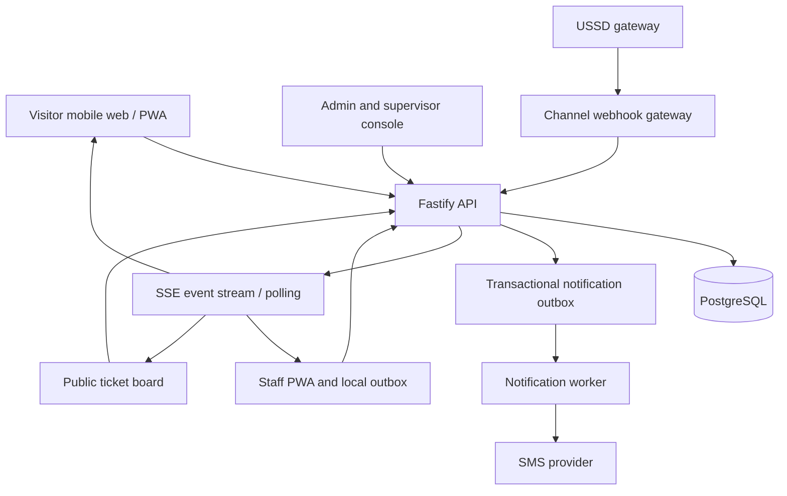

# QueueBridge — Technical Architecture v1.0

**Date:** 30 October 2026  
**Status:** Proposed implementation baseline (to validate with tests)  
**Source of truth:** `QueueBridge_PRD_v1.0.md`  
**Scope:** All ten committed capabilities plus SMS/USSD channels; complex enterprise integrations deferred.

## 1. Architecture decisions

| ID      | Decision                                              | Rationale                                                                                |
| ------- | ----------------------------------------------------- | ---------------------------------------------------------------------------------------- |
| ADR-001 | Modular TypeScript monorepo                           | Shared types and policies with clean boundaries                                          |
| ADR-002 | React + TypeScript mobile-first PWA                   | Visitor, staff, admin, and public-board experiences without mandatory installation       |
| ADR-003 | Fastify API + PostgreSQL                              | Transactional queue state changes and durable append-only events                         |
| ADR-004 | Server-authoritative **final** sequence               | Never assert two independently disconnected devices have globally final order            |
| ADR-005 | IndexedDB outbox + service worker                     | Local durability for explicitly permitted staff operations                               |
| ADR-006 | One designated coordinator per queue during an outage | Limit offline advancement authority; other devices only stage provisional actions        |
| ADR-007 | Explicit recovery after partitions                    | Reconcile commands, quarantine stale or conflicting operations; never silently overwrite |
| ADR-008 | Relational outbox for channel dispatch                | Reliable notification scheduling after database commits                                  |
| ADR-009 | Provider-neutral SMS and USSD adapters                | Provider selected after checking actual tariffs/approvals, not assumed                   |
| ADR-010 | Audit hash chain with external checkpoint option      | Detect ordinary event modification without claiming tamper-proof storage                 |

The browser PWA cannot guarantee local coordination among mutually disconnected devices. In this design, **the offline coordinator is the only device permitted to _locally enact_ queue advancement**, and even its decisions are marked `offline_applied` until the server confirms them. The central service remains the final authority. A partition that could produce conflicting decisions produces a visible review or pause, not a claim of conflict-free exact-once operation.

## 2. System context



**Runtime components**

- `apps/web`: visitor, staff, supervisor/admin, and public-display routes, React, responsive design, localization.
- `apps/api`: Fastify HTTP API with tenant-aware auth, queue service, policies, and sync endpoints.
- `apps/worker`: delivery of queued messages, retries, provider receipts, audit checkpoint verification jobs.
- `packages/contracts`: Zod schemas, shared enums, API DTOs and event schemas.
- `packages/domain`: ticket state machine, fairness policy, routing, wait-estimate algorithms; no database dependency.
- `packages/continuity`: local command schema, reconciliation logic, authority/fencing checks.
- `packages/channels`: SMS/USSD interfaces, provider adapters and test doubles.
- `packages/ui`: reusable accessible interface components.
- `infra`: database migrations, seed fixtures, CI configurations and deployment descriptors.

**Data flows**

1. Online commands are authenticated, validated, applied in one database transaction, and assigned a server sequence.
2. Offline staff commands are stored locally before success is shown. They carry a unique operation ID and proposed parent revision.
3. On reconnect, sync accepts each command at most once, revalidates permissions and policy, and returns per-command dispositions.
4. Public displays and visitor status show server-confirmed events; offline staff display additionally shows local applied or pending actions with clear labels.
5. SMS/USSD are gateway-mediated online; no promise that telecommunications work during an internet outage.

## 3. Tenant, queue, and authority boundaries

**Tenant hierarchy:** organization → facility → service → queue session. Counters may serve several compatible services. Every query and mutation is scoped by organization and facility. A `queue_session` identifies one operational queue for a dated service period.

**Authoritative sequence:** Each queue session has `revision` (integer), `last_sequence` (integer), and a row used to serialize state-changing transactions (`SELECT ... FOR UPDATE`). Every successfully committed command increments revision and creates a `queue_event` with a unique `(queue_session_id, sequence)`.

**Coordinator designation:** Online supervisor registers and assigns a staff device as designated offline coordinator for specified queue session(s), with a short-lived signed authorization containing device ID, queue ID, epoch and allowed commands. The coordinator may perform local _provisional_ calls and completions only while the offline capability remains valid.

**Split-brain limitation:** An offline device cannot verify that the server has _not_ replaced it while the network is partitioned. Therefore all offline actions remain provisional to the global state. The server can only finalize a batch when the coordinator epoch and base revision are still compatible. An incompatible epoch/revision is rejected or held for supervisor review; no conflicting local decision can become a second final server event. To protect visitors, the supervisor should not reassign offline authority merely because heartbeat is missing: use explicit revocation/failover workflow and warn about potential on-site divergence.

**Device isolation:** For a fully disconnected facility with multiple staff screens, only the designated coordinator can call/advance. Other disconnected devices can capture provisional tickets with temporary local references. No multi-device shared offline synchronization is claimed without an actual local network communication protocol.

**Failure behavior**

- Coordinator browser restart: replay persisted IndexedDB operations and preserve local labels.
- Coordinator missing/lost: suspend offline advancement until an authorized supervisor recovers the coordinator or explicitly performs a failover. Record the action.
- Server available to other staff but coordinator offline: server may continue online only with an explicit operational policy; resulting conflicts force coordinator offline commands into review. For a conservative default, block incompatible online advancement until authority is resolved.
- Expired coordinator credential: stop offline advancement, allow provisional ticket capture only.
- Browser storage cleared/damaged: warn that un-synced actions cannot be recovered from that device; do not imply durable backup without another replica.

## 4. Ticket state machine

**Primary states:** `waiting`, `called`, `serving`, `paused`, `missed`, `completed`, `cancelled`, `transferred`, `needs_review`.

Allowed transitions (subject to role, service policy and version):

- create → waiting
- waiting → called | paused | cancelled | transferred
- called → serving | missed | waiting (authorized recall)
- serving → completed | paused | transferred
- paused → waiting | cancelled
- missed → waiting (grace rule) | cancelled
- transferred → waiting in destination queue with linked parent event
- `needs_review` → a supervisor-approved resolution; never direct client-side overwrite

A ticket has a stable globally unique ID only after server commit; offline creates receive a client-generated `operation_id` and `temporary_ticket_ref`. Display must distinguish provisional reference from a confirmed public ticket number.

## 5. Synchronization protocol

### Client command envelope

```json
{
  "operation_id": "uuid-v7",
  "organization_id": "org-id",
  "facility_id": "facility-id",
  "queue_session_id": "queue-id",
  "device_id": "device-id",
  "actor_id": "staff-id",
  "coordinator_epoch": 17,
  "base_revision": 42,
  "client_sequence": 3,
  "action": "ticket.call_next",
  "payload": { "counter_id": "counter-id" },
  "created_at_client": "2026-10-30T17:00:00Z",
  "schema_version": 1
}
```

Client timestamps are diagnostic only and **never determine global ordering**. Authorization identity is derived from authenticated server-side credentials, not trusted because a payload says so.

### Server transaction for each synchronized command

1. Authenticate device, actor, organization, and facility; enforce permission, current session and service policy.
2. Deduplicate by unique `(organization_id, operation_id)`; return the previously stored disposition for exact replay.
3. Lock the queue session row; verify acceptable epoch, base revision, state preconditions and command ordering.
4. Validate operation-specific constraints (e.g., ticket eligible, counter compatible, supervisor reason recorded).
5. Atomically apply state, append authoritative event with new sequence/revision, record command result and insert notification outbox entries.
6. Return `committed`, `duplicate`, `rejected` or `needs_review` with updated sequence/revision and any temporary→final ticket mapping.

A batch is processed in deterministic per-device `client_sequence` order; the protocol does not promise atomicity for the entire batch unless requested and supported. Retries must be safe when a response is lost after commit.

### Conflict examples

| Scenario                                            | Handling                                                                                             |
| --------------------------------------------------- | ---------------------------------------------------------------------------------------------------- |
| Repeat sync after timeout                           | Return stored result; do not re-call ticket                                                          |
| Offline registration duplicates online registration | Reject or link only with defensible identity/dedup policy; surface review rather than silently merge |
| Two independent call-next attempts                  | Only one server sequence can commit for a given state; other is rejected/reviewed                    |
| Old coordinator reconnects after failover           | Fence stale epoch; show conflict review                                                              |
| Supervisor changed priority rules mid-outage        | Revalidate; reject or review commands with changed policy assumptions                                |
| Queue session closed during outage                  | Do not silently move tickets into new session; review and explicit migration                         |
| Clock skew                                          | Server controls ordering and expiry evaluation                                                       |

**Non-negotiable UI states:** `local_only`, `pending_sync`, `committed`, `duplicate`, `needs_review`, `rejected`. The visitor-facing view never displays offline local-only progress as a globally confirmed state.

## 6. Core database model

Suggested PostgreSQL tables (fields abbreviated):

- `organizations(id, name, created_at)`
- `facilities(id, organization_id, name, timezone, status)`
- `staff_users(id, organization_id, auth_subject, status)`
- `role_assignments(id, staff_user_id, facility_id, role)`
- `services(id, facility_id, name, priority_policy_id)`
- `counters(id, facility_id, name, active)`
- `counter_service_capabilities(counter_id, service_id)`
- `queue_sessions(id, facility_id, service_id, operational_date, state, revision, last_sequence, coordinator_epoch, coordinator_device_id)`
- `tickets(id, queue_session_id, public_code, provisional_source_op_id, state, priority_class, issued_sequence, current_counter_id, version, contact_id)`
- `ticket_transitions(id, ticket_id, from_state, to_state, queue_event_id)`
- `devices(id, facility_id, staff_user_id, public_key_or_session_ref, revoked_at)`
- `client_operations(id, organization_id, queue_session_id, device_id, actor_id, operation_id, client_sequence, action, status, result_json, created_at)`
- `queue_events(id, organization_id, queue_session_id, sequence, actor_id, operation_id, event_type, payload, prev_hash, event_hash, committed_at)`
- `priority_overrides(id, ticket_id, actor_id, reason_code, reason_text, policy_version, queue_event_id)`
- `visitor_contacts(id, organization_id, phone_ciphertext, consent_at, retention_until)`
- `ticket_recovery_credentials(id, ticket_id, credential_hash, expires_at, attempts)`
- `notifications(id, organization_id, ticket_id, channel, template_key, status)`
- `notification_outbox(id, notification_id, dedup_key, payload, attempt_count, next_attempt_at)`
- `notification_deliveries(id, notification_id, provider, provider_message_id, receipt_status, recorded_at)`
- `ussd_sessions(id, provider_session_key_hash, facility_id, state, expires_at)`
- `device_sync_cursors(id, device_id, queue_session_id, last_server_sequence, synced_at)`
- `audit_checkpoints(id, queue_session_id, from_sequence, to_sequence, root_hash, signature, created_at)`

**Required constraints:** unique `(queue_session_id, sequence)`, unique `(organization_id, operation_id)`, unique `(queue_session_id, public_code)`, scoped foreign keys where feasible, indexes on queue state/counter and outbox scheduling. Avoid exposing raw phone numbers in events.

## 7. API contracts

Versioned JSON API `/api/v1`:

| Method / route                          | Role                        | Result                                       |
| --------------------------------------- | --------------------------- | -------------------------------------------- |
| `POST /facilities`                      | org admin                   | Create facility and setup                    |
| `POST /facilities/:id/services`         | admin                       | Define service                               |
| `POST /facilities/:id/counters`         | admin                       | Configure counter                            |
| `POST /queues/:id/join`                 | visitor / staff             | Confirmed ticket (or explicit request error) |
| `GET /tickets/:publicCode/status`       | ticket credential           | Status, freshness and estimate               |
| `POST /tickets/recover`                 | visitor                     | Recover scoped status access                 |
| `POST /queues/:id/commands`             | staff                       | Online state transition                      |
| `POST /sync/batches`                    | authorized staff device     | Per-operation sync dispositions              |
| `GET /sync/queues/:id/snapshot`         | authorized device           | Revision, state and events after cursor      |
| `GET /queues/:id/stream`                | authorized / limited public | SSE updates                                  |
| `POST /tickets/:id/priority-override`   | supervisor                  | Audited policy change                        |
| `GET /facilities/:id/operations/health` | supervisor                  | Device sync/freshness summary                |
| `GET /queues/:id/audit`                 | auditor                     | Paginated immutable sequence                 |
| `POST /webhooks/sms/:provider`          | provider webhook            | Verified receipt/inbound event               |
| `POST /webhooks/ussd/:provider`         | provider webhook            | Verified USSD dialogue response              |

**Public endpoints** require abuse protection, token-based access to sensitive ticket data, and explicit data minimization. Queue board uses a redacted projection, not admin responses.

Errors: structured code, safe message, correlation ID, retryability hint. Define RFC 9457-style problem responses consistently.

## 8. Routing and fairness

- Default selection: eligible ticket ordering according to facility policy (e.g., priority class → issue sequence), never opaque arbitrary sorting.
- `priority_override` requires supervisor role, valid configured reason and appended event.
- A counter can only call tickets for services in its capability set.
- Transfers produce old→new linkage and a reason; preserve elapsed time policy and original join time as distinct fields.
- Fairness diagnostics: counts of overrides, skipped tickets, wait distributions by service and priority class; no unreviewed clinical prioritization.
- Use deterministic policy versioning so replay produces same selection given the same authoritative event history.

## 9. Wait estimates and accessibility

**ETA:** estimate an interval from active counter count, eligible tickets ahead and bounded observed service-time samples; fall back to a wide interval / “insufficient data”. Include `calculated_at`, sample size and explanatory factors. Never promise exact service time.

**Accessibility:** WCAG 2.2 AA target for key flows, keyboard controls, screen-reader announcements, high-contrast/large-text option, no color-only status, no account required for visitor join, multilingual text keys. Public board uses ticket codes only, never names or phone numbers.

## 10. Notification and telecom design

`ChannelAdapter` interface:

- `sendMessage({to, template, params, idempotencyKey})`
- `verifyWebhook(headers, body)`
- `parseDeliveryReceipt(payload)`
- `parseInboundMessage(payload)` where available
- `handleUssdSession({sessionKey, msisdn, input, facility})`

The worker consumes a transactional notification outbox. Delivery attempts are deduplicated; provider receipts update status idempotently. Retries are bounded and observable. Provider failure does not roll back a committed queue action.

USSD requires actual provider gateway support, a service code and possibly operator approval. The system will implement session state, input validation, timeouts, service lookup and live gateway adapters **after** reviewing provider costs. SMS and USSD provider selections can be independent. Sandbox traffic must be unmistakably labeled as test traffic.

**Provider decision sheet:** coverage by Nigerian networks, sender identity, code/setup charges, per-unit SMS fees, per-session USSD fees, inbound availability, webhook authentication, delivery receipts, onboarding/KYC, sandbox, support, hard spending controls.

## 11. Security, privacy and audit

- Authenticate staff and devices; RBAC on server, scoped tenancy on all mutable reads/writes.
- Use Secure/HttpOnly cookies with CSRF mitigation where appropriate, rate limits and structured input validation.
- Encrypt contact data where required, restrict retention and never embed sensitive PII in public queue events.
- Protect ticket recovery with random scoped credentials, hashes at rest, expiry and throttling.
- Keep local offline data minimal; provide controlled local-data clearing and compromised-device revocation.
- Compute `event_hash = SHA256(domain_separator || queue_id || sequence || prev_hash || canonical_event_json)` and periodically sign/hash checkpoint summaries. Verification detects alteration within the trust model; an administrator with control over all keys and storage may still rewrite history.
- Record actor, policy version and reason for overrides and authority transfers.
- Verify telecom webhooks with provider-supported signatures or secure alternatives; reject replays and enforce request limits.

## 12. Testing and quality gates

**Core invariants**

- No two final authoritative events share a queue sequence.
- No mutation creates duplicate committed ticket codes in one queue.
- An identical operation ID cannot apply twice even after timeouts/retries.
- A fenced coordinator cannot finalize obsolete offline actions.
- Unauthorized actors cannot commit staff or supervisor transitions.
- Ticket status shown as committed must have a server event behind it.
- Priority overrides always have a named actor, policy and reason.

**Test groups**

1. Pure domain state-machine and routing property tests.
2. Concurrent Postgres transaction tests for `call-next` and registration.
3. Offline outbox tests: browser kill, queued writes, replay, clock skew, storage exceptions.
4. Partition simulations: stale epoch, simultaneous online/offline operations, failover, lost ACK.
5. Sync batch fuzzing and idempotency across duplicated/reordered messages.
6. Multi-tenant access, recovery guessing and rate-limit security tests.
7. Audit chain tamper-detection tests with known checkpoints.
8. Accessibility/keyboard tests on all visitor flows.
9. Provider contract and webhook signature tests in sandboxes.
10. Scripted end-to-end outage/reconnect demo on a real device.

Targets in PRD (e.g. 1,000 scripted operations and zero duplicate finals) are acceptance targets, **not measured results** until validated.

## 13. Delivery sequence and milestone gates

| Milestone | Scope                                                                     | Exit criteria                                                     |
| --------- | ------------------------------------------------------------------------- | ----------------------------------------------------------------- |
| M0        | Monorepo, contracts, AGENTS.md, `.kiro` steering/specs, CI, migrations    | Typecheck/lint/test and reproducible environment                  |
| M1        | Tenancy, roles, facility/service/counter setup                            | Permission and isolation checks pass                              |
| M2        | Ticket state machine, online queue, staff and visitor flows, public board | Full online join-to-completion flow                               |
| M3        | Offline outbox, designated authority, sync protocol, conflict/recovery UI | Partition/duplicate/failover tests pass                           |
| M4        | Fairness, overrides, audit integrity, routing, ETA                        | Deterministic policy and integrity tests                          |
| M5        | Ticket recovery, accessibility, device health, visitor polish             | Accessibility and recovery scenarios pass                         |
| M6        | SMS and USSD contracts, adapters, sandbox/live provider gates             | Simulated E2E and live only with approved access                  |
| M7        | Load/security hardening, demo data, docs, Kiroween video/submission       | All ten core capabilities demonstrated, public artifacts complete |

Milestones are an implementation order, not permission to drop required features.

## 14. Persistent Kiro development workflow

Create:

- Root `AGENTS.md`: architecture invariants, security rules, testing and review expectations.
- `.kiro/steering/product.md`: PRD scope, users, non-goals.
- `.kiro/steering/architecture.md`: modules, trust boundaries, persistence.
- `.kiro/steering/testing.md`: mandatory tests and demo acceptance.
- `.kiro/specs/queuebridge/requirements.md`, `design.md`, `tasks.md`: spec-driven development traceability.
- `docs/adr/`: dated architectural decisions; `docs/testing/`: evidence.
- `README.md`: public setup, diagrams and what Kiro materially contributed.

Do not claim Kiro performed implementation work unless it actually did. Preserve proof of meaningful Kiro-assisted planning/development for the hackathon.

## 15. Open implementation decisions

1. Pick exact auth/session framework and migration toolkit.
2. Validate offline coordinator delegation and failover UX through a controlled partition prototype; keep global finality conservative.
3. Decide realistic local-sharing capability (single coordinator screen vs local hotspot). Do not imply local peer synchronization if not implemented.
4. Define retention windows, privacy notice and consent semantics.
5. Select Nigerian SMS and USSD providers after actual tariffs and approvals are checked.
6. Decide primary demonstration environment (suggest campus service office or generic clinic admin desk, no medical triage).
7. Establish measured performance budgets through baseline tests, not guesses.

## 16. Architectural acceptance gate

Before implementing offline advancement, a reviewer must be able to answer:

- Who may advance the queue when the internet disappears?
- Which progress is _local only_, and which is globally confirmed?
- What happens when two devices or a server disagree?
- Can duplicate requests change queue state twice?
- What happens if a coordinator loses its device or storage?
- How can a staff member recognize and resolve a conflicted operation?
- How will a real reconnect demo prove the above behavior?

**Until these are answered in both code and tests, QueueBridge must not describe its offline behavior as conflict-free or globally final.**

---

## Addendum A — Ask Que Anything (F13) architecture notes (planned; added 2026-11-07)

> Additive to §1–§16; none of the existing decisions, gates or milestone rows change.
> Decision record: ADR-011. Detailed design: `.kiro/specs/queuebridge/design.md` §11.

### A.1 Placement and trust boundaries

```text
apps/web ──(Ask Que panel, offline search, route registry)──> packages/assist (pure, no I/O)
   │  public KB bundle (service-worker precache)
   │  restricted KB bundle (per-user cache)  <── GET /api/v1/que/kb  (auth + role filter)
   └─ POST /api/v1/que/ask ──> apps/api ──> InferenceAdapter (disabled | sandbox | approved provider)
                                     └─ output guard ──> deterministic fallback
```

- `packages/assist` imports `contracts` only (same rules as `domain`).
- Inference runs server-side only; credentials stay in `apps/api` environment variables.
- Que has no write path to tenant tables; it is outside the authoritative sequence (ADR-004).

### A.2 Content and truthfulness

- Versioned Markdown knowledge base compiled to per-audience JSON bundles.
- Capability manifest (`live | preview | sandbox | planned`) generated from server flags gates what
  Que may describe as available.

### A.3 Authorization

- Navigation and content are filtered by the same permission map the API enforces.
- Restricted articles are filtered server-side; caches are per user and purged on sign-out or role
  change. Visitors receive the public bundle only.

### A.4 Offline

- Deterministic search and navigation run entirely in the browser from cached bundles.

### A.5 AI layer and fallback ladder

`ai_disabled → offline → quota/cap → timeout → provider_error → validation_failed` each resolve to
deterministic help with a visible reason. Questions are redacted of likely PII; only authorized
KB excerpts are sent; no tools are exposed; output is validated before display.

### A.6 Accessibility

Shell-level trigger, focus-managed panel/sheet, live-region announcements, text labels for
offline/AI states, WCAG 2.1 A/AA at 320/375/desktop.

### A.7 Milestone row (additive to §13)

| Milestone                | Scope                                                                                                | Exit criteria                                                                |
| ------------------------ | ---------------------------------------------------------------------------------------------------- | ---------------------------------------------------------------------------- |
| MQ (after M5, before M6) | Ask Que: deterministic KB + navigation, offline delivery, accessible UI, optional zero-cost AI layer | Group 13 tests pass; usable offline and with AI disabled; read-only verified |
