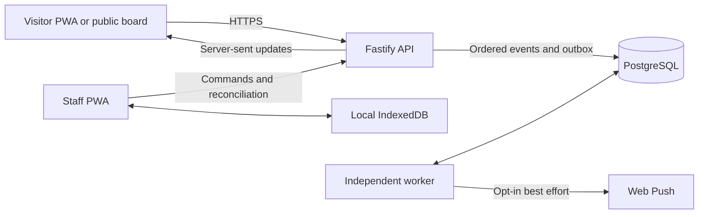

# How QueueBridge works

**Authority and fairness.** Staff sign in within an organization. The API checks the session, facility grants and command permission. Visitors use a private credential for protected ticket operations. A ticket progresses from waiting to called, serving and completed under the queue state machine. Counter capabilities restrict which services a desk can take. The ordering policy selects the next eligible ticket. An authorized override records the actor, policy and reason. Wait estimates use position, compatible counters and recent service durations, with an explicit insufficient-data result. [Queue domain](../../packages/domain/src) · [API routes](../../apps/api/src/routes) · [Contracts](../../packages/contracts/src)

**During an outage.** The service worker makes the application shell available and IndexedDB retains local continuity state. The designated coordinator records permitted commands with operation IDs and its authority epoch. On reconnect, the server checks scope, authority and sequence, deduplicates replays and returns a disposition for each operation. Pending work can become committed, duplicate, rejected or require review. The connectivity view lets a supervisor investigate outstanding work. [Continuity decisions](../archive/adr/ADR-006-single-offline-coordinator.md) · [Partition recovery](../archive/adr/ADR-007-explicit-partition-recovery.md)

**History and alerts.** PostgreSQL stores the authoritative sequence, linked event hashes and notification outbox. The worker periodically creates signed checkpoints that auditors can verify. A committed call can trigger an in-app alert and optional Web Push. Device support, permission and provider availability affect delivery. Alert failure never advances or cancels a ticket. The internal SMS simulation requires consent and supports opt-out. The USSD simulator exercises the menu against the queue application. [Audit design](../archive/adr/ADR-012-fairness-policy-routing-audit-checkpoints.md) · [Turn alerts](../archive/adr/ADR-013-smart-turn-alerts.md)

**Runtime.** RumptyCloud serves the React/Vite PWA and Fastify API from one HTTPS origin. One independently supervised worker uses the same reviewed image and PostgreSQL database. PostgreSQL holds both durable work and audit state. The implemented topology requires no Redis service. The worker uses the verified database CA launcher, as does the web role. Deployments are manual, with migrations run separately and a single active worker during release. [Deployment and rollback runbook](../deployment/RUMPTYCLOUD-DEPLOYMENT.md)

**Assistance and privacy.** Ask Que offers curated help and routes appropriate to the current role and available capabilities. It cannot issue tickets, change priorities or grant permissions. Optional AI is disabled for judging. The API restricts staff-assisted recovery, and a low-assurance request requires another authorized approver. [Ask Que](../archive/adr/ADR-011-ask-que-deterministic-first-assistant.md) · [Ticket recovery](../archive/adr/ADR-015-ticket-recovery-and-automatic-no-show.md)

The React visitor experience includes keyboard navigation, adjustable contrast and text size, reduced motion settings and accessible status announcements.
